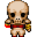
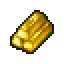
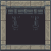
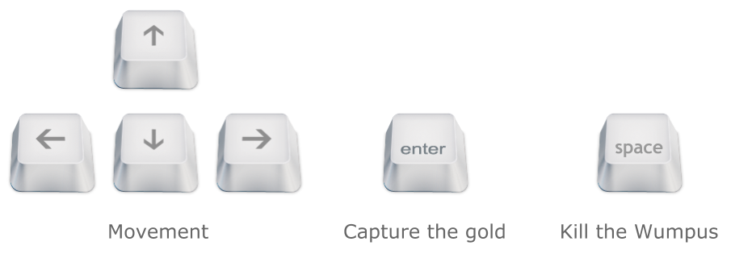

# 🐉 Wumpus World: Audio Edition

[](https://www.oracle.com/java/)
[](https://docs.oracle.com/javase/tutorial/uiswing/)
[](https://docs.oracle.com/javase/tutorial/sound/)
[](https://en.wikipedia.org/wiki/Hunt_the_Wumpus)
[](LICENSE)

> **A tactical, graphical implementation of the classic Artificial Intelligence benchmark "Hunt the Wumpus" featuring fog-of-war, directional tank movement, procedural cave hazards, and an immersive spatial audio engine.**

---

## 🎮 Game Showcase & Entity Sprites

| Explorer | Dreaded Wumpus | Treasure Gold | Bottomless Pit |
| :---: | :---: | :---: | :---: |
|  |  |  |  |
| *Hero Explorer* | *Smelly Beast* | *Winning Prize* | *Fatal Fall* |

<div align="center">
  <br/>
  
  <p><em>Built-in Heads-Up Display (HUD) showing key mechanics and movement rules</em></p>
</div>

---

## 🌟 The AI Benchmark (Russell & Norvig PEAS)

In artificial intelligence literature (*AIMA* by Stuart Russell and Peter Norvig), Wumpus World serves as the quintessential testbed for knowledge-based agents, logical deduction, and reasoning under partial observability.

```
+---+---+---+---+
| P |   | W | G |  4
+---+---+---+---+
|   | P |   |   |  3
+---+---+---+---+
| S |   | P |   |  2  P = Pit
+---+---+---+---+     W = Wumpus
| A | S |   |   |  1  G = Gold
+---+---+---+---+     A = Agent Start
  1   2   3   4
```

### PEAS Formal Specification:
- **Performance Measure**: 
  - `+1000` points for climbing out of the cave with the Gold.
  - `+1000` points for shooting and slaying the Wumpus.
  - `-1000` points for dying (falling into a bottomless Pit or being devoured by the Wumpus).
  - `-10` points for using your single enchanted Arrow.
  - `-1` point for each action/step taken.
- **Environment**: A `4 × 4` underground grid with procedural hazard distribution:
  - Bottomless **Pits** generated randomly in empty rooms.
  - Exactly **1 Wumpus** slumbering in a hidden chamber.
  - Exactly **1 Heap of Gold** glittering in the dark.
  - Explorer starts safely in square `(0, 0)` facing Down.
- **Actuators**: Turn (Up, Down, Left, Right), Move Forward, Shoot Arrow, Grab Gold.
- **Sensors**: Perceived only in the player's immediate or adjacent rooms:
  - 💨 **Breeze**: Felt in rooms directly adjacent (Manhattan distance = 1) to a Pit.
  - 🦨 **Stench**: Smelled in rooms directly adjacent to the Wumpus.
  - ✨ **Glitter**: Seen only when standing directly on the Gold chamber.
  - 💥 **Bump**: Heard and felt when attempting to walk into the outer cave boundary.
  - 😱 **Scream**: Echoes throughout the entire cave system when the Wumpus is slain.

---

## ✨ Gameplay Features

- 🎭 **Fog of War**: Unexplored subterranean chambers remain pitch black until you boldly step into them.
- 🧭 **Tactical Tank Navigation**:
  - Tap an arrow key **once** to pivot and face that cardinal direction (`UP`, `DOWN`, `LEFT`, `RIGHT`).
  - Tap the **same arrow key a second time** to advance forward into the adjoining room.
- 🔊 **Dynamic Audio Architecture**:
  - Atmospheric cave background loop (`assets/audio/background.wav`).
  - Spatial sound effects for every player action: footsteps, wall bumps, arrow flight (`arrow.wav`), coin pickups (`coin.wav`), death groans (`game-over.wav`), and victory fanfare (`win.wav`).
- 🎯 **Single Enchanted Arrow**:
  - You carry only **one arrow**. It travels in a straight line along the direction you are facing until it hits the Wumpus or the cave wall. Shoot wisely!

---

## 🎯 Controls & Mechanics

| Key / Action | In-Game Function |
| :--- | :--- |
| **Arrow Keys** (Single Tap) | Turn player to face North, South, East, or West |
| **Arrow Keys** (Double Tap) | Step forward into the faced chamber |
| **Spacebar** | Fire your single arrow straight ahead |
| **G** | Pick up Gold when standing on a glittering tile |
| **C** | Toggle on-screen Controls HUD |
| **R** | Restart cave generation after Victory or Defeat |

---

## 🏆 Victory Conditions

To achieve complete victory:
1. Navigate through the sensory hazards using logical deduction.
2. Slay the Wumpus by shooting an arrow straight into its chamber.
3. Retrieve the Gold (`G` key when standing on the gold tile).

---

## 🚀 How to Compile & Play

### Prerequisites
- **Java Development Kit (JDK)** 17 or higher
- Audio output enabled

### 1. Clone the Repository
```bash
git clone https://github.com/akshadit/wompus_world.git
cd wompus_world
```

### 2. Compile & Launch
```bash
# Compile the Java Swing source code
javac WumpusGame.java

# Run the game
java WumpusGame
```

---

## 📂 Project Structure

```
wompus_world/
├── WumpusGame.java          # Core Swing engine, game loop, AI logic & audio player
├── README.md                # Documentation & game guide
└── assets/
    ├── audio/               # WAV audio sound effects & background ambience
    │   ├── arrow.wav        # Arrow projectile sound
    │   ├── background.wav   # Ambient subterranean soundtrack
    │   ├── bump.wav         # Wall collision feedback
    │   ├── coin.wav         # Gold pickup sound
    │   ├── game-over.wav    # Defeat audio cue
    │   └── win.wav          # Victory fanfare
    └── images/              # Custom 2D pixel-art sprites
        ├── controls.png     # On-screen HUD diagram
        ├── floor.png        # Explored room floor tile
        ├── floor_gold.png   # Gold room floor tile
        ├── gold.png         # Gold sprite
        ├── hole.png         # Bottomless pit sprite
        ├── wumpus.png       # Monster sprite
        └── player_facing_*.png # 4-directional player sprites
```

---

## 📄 License

Distributed under the [MIT License](LICENSE).
